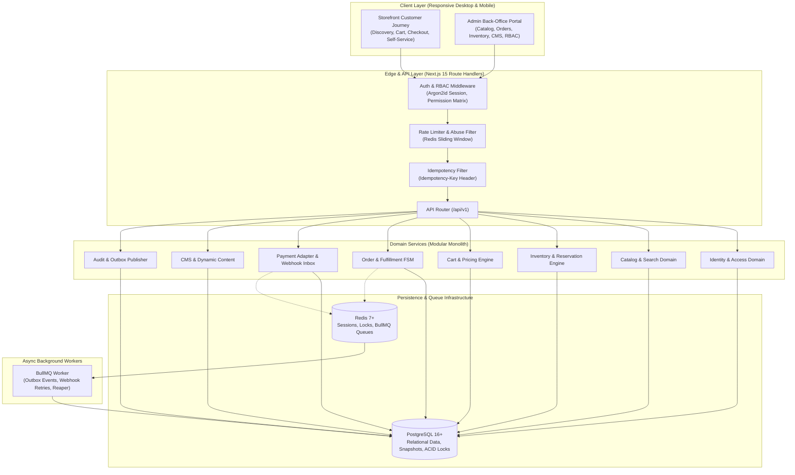

# System Architecture & Technical Specifications

**Document Version:** 1.0.0  
**Baseline:** Production-Grade E-Commerce Platform (`Ecommerce_PRD.md`)  
**Architecture Style:** Modular Monolith (Type-Safe, Multi-Tenant Ready, Event-Driven Internal Integration)

---

## 1. High-Level Architecture Overview

The system is architected as a **Modular Monolith** using Next.js 15 (React 19, TypeScript, App Router) running on Node.js 22 LTS, backed by PostgreSQL 16+ for relational persistence and Redis 7+ for caching, rate limiting, and background job queues.

---

## 2. Key Architecture Principles

1. **Separation of Concerns & 3-Tier Layering:**
   - **Route Handlers (`src/app/api/v1/...`):** HTTP parsing, Zod request/response validation, authentication resolution, and error envelope formatting.
   - **Domain Services (`src/modules/.../*.service.ts`):** Pure business logic, authorization verification, domain event generation, and cross-module choreography.
   - **Repositories (`src/modules/.../*.repository.ts`):** Database queries, transaction boundaries, and row-level locking.
2. **Server-Authoritative Arithmetic:**
   - Client applications never calculate prices, discounts, taxes, or shipping totals for persistence. The server calculates all totals dynamically during checkout quoting and order creation.
   - Monetary values are stored strictly as integer minor units (`amount_minor: integer`, e.g. `$19.99` $\rightarrow$ `1999`) paired with an ISO currency code (`USD`).
3. **Atomic Concurrency & Zero Overselling:**
   - Inventory reservation relies on an atomic conditional SQL `UPDATE` statement that checks `(on_hand_quantity - reserved_quantity - safety_stock) >= requested`.
   - Checkout operations submit a client-generated `idempotency_key` to prevent duplicate charges or order creations.
4. **Durable Webhook Inbox & Asynchronous Outbox:**
   - Payment webhooks are validated via HMAC signatures and immediately persisted to a durable `payment_events` table before acknowledgement (`200 OK`).
   - Webhook processing is idempotent and transitions the Order State Machine safely.
   - Side-effects (such as transactional emails) are written to an `outbox_events` table within the same database transaction as the order mutation, then dispatched by background workers.

---

## 3. Database Architecture & Schema Strategy

The database schema encapsulates 24+ core relational entities defined in PRD Section 16:
- **Identity & RBAC:** `users`, `roles`, `permissions`, `user_roles`, `role_permissions`, `customer_profiles`, `addresses`.
- **Catalog & Media:** `categories`, `products`, `product_variants`, `product_media`, `prices`.
- **Inventory & Stock Movements:** `inventory`, `stock_movements`, `inventory_reservations`.
- **Cart & Pricing:** `carts`, `cart_items`, `promotions`, `promotion_redemptions`.
- **Orders & Fulfillment:** `orders`, `order_items`, `order_addresses`, `order_status_history`, `shipments`, `return_requests`.
- **Payments & Accounting:** `payment_attempts`, `payment_events`, `refunds`.
- **CMS & Operations:** `cms_pages`, `cms_revisions`, `audit_logs`, `outbox_events`.

---

## 4. Security Architecture

1. **Authentication:**
   - Password hashing: Argon2id or bcrypt (salt rounds = 12).
   - Session management: Cryptographically signed session cookies with `HttpOnly`, `SameSite=Lax`, and `Secure` attributes.
   - Password reset: Single-use, 15-minute expiration tokens stored as SHA-256 hashes.
2. **Authorization (RBAC):**
   - Centralized RBAC guard middleware checking user roles and explicit permission grants on every protected API endpoint.
   - Deny-by-default access model.
3. **OWASP Protections:**
   - Parameterized queries to eliminate SQL injection.
   - DOMPurify sanitization for rich text content to prevent XSS.
   - IDOR prevention through server-side ownership filters and non-guessable public references.
   - Log redaction ensuring passwords, card numbers, and PII are never logged.

---

## 5. API Contracts & External Interfaces

Detailed REST API specifications, request/response schemas, idempotency semantics, standard envelope formats, and error code definitions are maintained in [API_CONTRACT_V1.md](file:///c:/Users/Mitab%20Sany/Documents/Personal%20Projects/E-commerce/src/docs/API_CONTRACT_V1.md).
