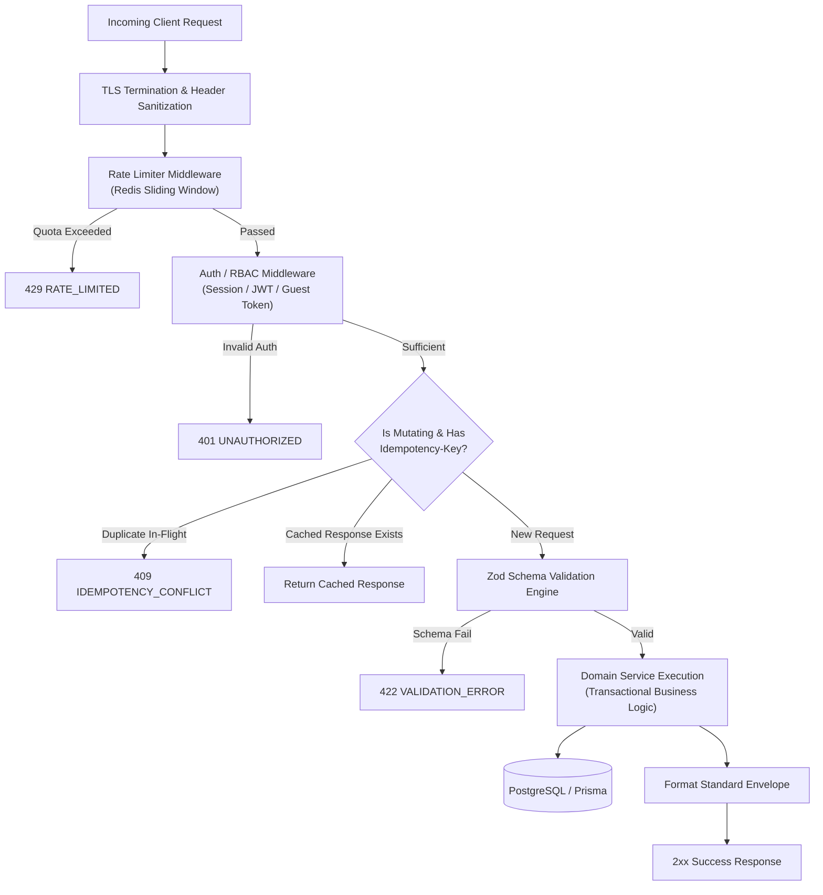
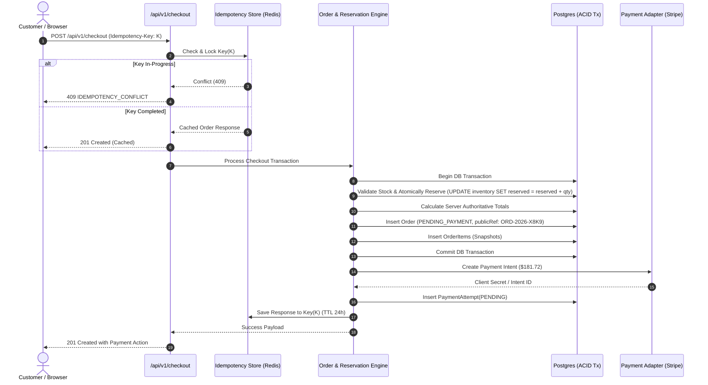
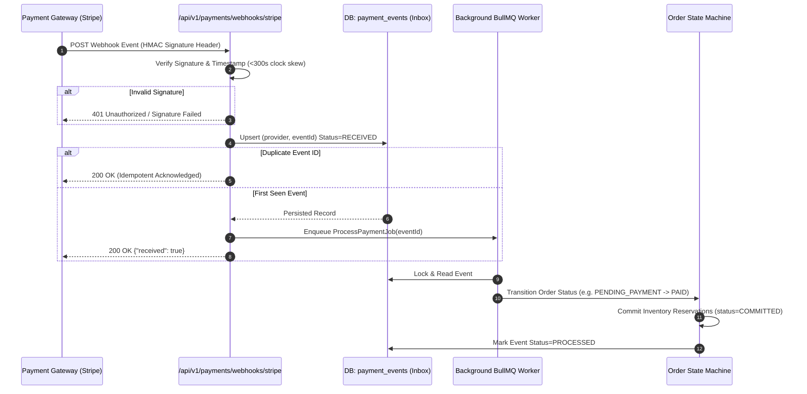

# REST API Contract Specification (v1.0.0)

**Document Version:** 1.0.0  
**Status:** Active Draft (Baseline Specification)  
**Conformance:** [Ecommerce_PRD.md](file:///c:/Users/Mitab%20Sany/Documents/Personal%20Projects/E-commerce/Ecommerce_PRD.md) Section 17, [SYSTEM_ARCHITECTURE.md](file:///c:/Users/Mitab%20Sany/Documents/Personal%20Projects/E-commerce/SYSTEM_ARCHITECTURE.md), and [schema.prisma](file:///c:/Users/Mitab%20Sany/Documents/Personal%20Projects/E-commerce/prisma/schema.prisma)  
**Standard:** OpenAPI 3.0 / RESTful JSON over HTTPS  
**Base URL:** `/api/v1`  
**Default Content-Type:** `application/json; charset=utf-8`  

---

## 1. Global Architectural Conventions & Protocols

### 1.1 Protocol & Transport
- All communication requires **HTTPS** with TLS 1.3 preferred (TLS 1.2 minimum).
- All payloads are JSON encoded using UTF-8 encoding.
- Route Handlers reside under `src/app/api/v1/...` conforming to Next.js 15 App Router conventions.

### 1.2 Standard HTTP Headers

| Header | Type | Required | Description |
|---|---|---|---|
| `Content-Type` | String | Required on POST/PUT/PATCH | Must be `application/json`. |
| `Accept` | String | Recommended | Must accept `application/json`. |
| `X-Request-ID` | String | Optional (Auto-generated if absent) | Client-supplied UUIDv4 or server-generated NanoID for end-to-end distributed tracing. |
| `Idempotency-Key` | String | **Mandatory** on mutating financial / order operations | Unique client UUIDv4/NanoID to guarantee at-most-once execution (PRD 17.1, 17.4). |
| `Authorization` | String | Conditional | `Bearer <session_token>` for token-based API authentication. Cookie-based session (`ecom_session`) also supported. |
| `X-Guest-Cart-Token` | String | Conditional | Opaque high-entropy token used to resolve guest carts across shopping sessions (PRD FR-CART-007). |
| `Stripe-Signature` | String | Webhooks only | HMAC-SHA256 signature generated by payment provider to verify payload authenticity and prevent replay attacks. |

### 1.3 Uniform Envelope Format

In compliance with PRD Section 17.2, all endpoints return consistent envelope structures for both successful executions and error states.

#### Success Envelope (2xx HTTP Codes)
```json
{
  "data": {
    "item": {}
  },
  "meta": {
    "request_id": "req_01HP8Z8Q50C2V0T090G3K9A3",
    "timestamp": "2026-11-10T14:30:00.000Z",
    "pagination": {
      "page": 1,
      "limit": 20,
      "total": 142,
      "totalPages": 8,
      "hasNext": true,
      "hasPrev": false
    }
  }
}
```

#### Error Envelope (4xx and 5xx HTTP Codes)
```json
{
  "error": {
    "code": "VALIDATION_ERROR",
    "message": "Please review the submitted information.",
    "details": [
      {
        "field": "quantity",
        "code": "OUT_OF_RANGE",
        "message": "Quantity must be an integer between 1 and 10."
      }
    ],
    "request_id": "req_01HP8Z8Q50C2V0T090G3K9A3",
    "timestamp": "2026-11-10T14:30:00.000Z"
  }
}
```

> [!IMPORTANT]
> In accordance with PRD Section 17.2 and 18.2, public error messages must **never** return internal secrets, database stack traces, or raw third-party payment payloads.

### 1.4 Standard Error Codes Catalog

| HTTP Status | Error Code (`error.code`) | Description & Trigger Scenario |
|---|---|---|
| `400` | `BAD_REQUEST` | Malformed JSON, unparseable payload, or missing mandatory headers. |
| `400` | `INVALID_IDEMPOTENCY_KEY` | The supplied `Idempotency-Key` header is missing, malformed, or exceeds 255 chars. |
| `401` | `UNAUTHORIZED` | Missing, invalid, or expired authentication token / session cookie. |
| `401` | `INVALID_CREDENTIALS` | Login failure due to incorrect email or password. |
| `403` | `FORBIDDEN` | Authenticated actor lacks required RBAC permission or attempts IDOR resource access. |
| `403` | `ACCOUNT_SUSPENDED` | User account is in `SUSPENDED` or `DELETED` state. |
| `404` | `NOT_FOUND` | The requested entity (Product, Category, Cart, Order) does not exist. |
| `409` | `CONFLICT` | Concurrent modification conflict, or state pre-condition mismatch. |
| `409` | `IDEMPOTENCY_CONFLICT` | An operation with the same `Idempotency-Key` is currently executing or completed with different payload. |
| `409` | `INSUFFICIENT_STOCK` | Requested quantity exceeds available unreserved inventory (`on_hand - reserved - safety_stock`). |
| `409` | `PRICE_CHANGED` | Line item unit price shifted since addition to cart (PRD FR-CART-009). |
| `422` | `VALIDATION_ERROR` | Request body violates schema rules (field type, min/max bounds, email format). |
| `422` | `COUPON_INVALID` | Coupon code is expired, max uses reached, or cart does not meet minimum order amount. |
| `429` | `RATE_LIMITED` | Client exceeded rate-limiting quota (Sliding Window Redis counter). |
| `500` | `INTERNAL_SERVER_ERROR` | Unexpected server failure. An opaque error is logged with `request_id`. |
| `503` | `SERVICE_UNAVAILABLE` | External dependency unavailable (e.g. database connection pool exhaustion). |

### 1.5 Monetary Representation Standard
Following [money.ts](file:///c:/Users/Mitab%20Sany/Documents/Personal%20Projects/E-commerce/src/lib/money.ts) and PRD Section 7.2:
- All monetary figures are transferred as **integers in minor currency units** (e.g. cents).
- `$19.99 USD` is represented as `{ "amountMinor": 1999, "currency": "USD" }`.
- Client arithmetic is strictly forbidden; all line subtotals, taxes, discounts, shipping, and grand totals are authoritatively computed on the server.

---

## 2. Request Lifecycle & Middleware Architecture



---

## 3. Detailed Endpoint Specifications

### 3.1 Authentication Endpoints (PRD Section 17.3, 18.1)

#### 3.1.1 Register Customer Account
- **Route:** `POST /api/v1/auth/register`
- **Access:** Public (Rate-limited: 5 requests / minute / IP)
- **Description:** Creates a new customer account, sets up customer profile, hashes password using Argon2id/bcrypt, and returns initial authenticated session.

**Request Headers:**
```http
Content-Type: application/json
X-Request-ID: req_uuid4
```

**Request Body Schema:**
```json
{
  "email": "customer@example.com",
  "password": "SecurePassword#2026",
  "firstName": "Alex",
  "lastName": "Mercer",
  "phone": "+15550192834"
}
```

| Field | Type | Rules |
|---|---|---|
| `email` | String | Required, valid email format, max 255 chars, normalized to lowercase. |
| `password` | String | Required, min 10 chars, at least 1 uppercase, 1 lowercase, 1 number, 1 symbol. |
| `firstName` | String | Required, min 1, max 100 chars, trimmed. |
| `lastName` | String | Required, min 1, max 100 chars, trimmed. |
| `phone` | String | Optional, E.164 phone format if provided. |

**Response (201 Created):**
```json
{
  "data": {
    "user": {
      "id": "cuid_usr_01hp8z...",
      "email": "customer@example.com",
      "firstName": "Alex",
      "lastName": "Mercer",
      "status": "ACTIVE",
      "createdAt": "2026-11-10T14:35:00.000Z"
    },
    "sessionToken": "sess_tok_99a8b7..."
  },
  "meta": {
    "request_id": "req_uuid4",
    "timestamp": "2026-11-10T14:35:00.120Z"
  }
}
```

**Common Errors:**
- `400 BAD_REQUEST`: Malformed request JSON.
- `409 CONFLICT`: `EMAIL_ALREADY_EXISTS` — Email is already registered.
- `422 VALIDATION_ERROR`: Password complexity or name validation failed.
- `429 RATE_LIMITED`: Exceeded maximum registration attempts.

---

#### 3.1.2 Authenticate & Login
- **Route:** `POST /api/v1/auth/login`
- **Access:** Public (Rate-limited: 5 attempts per 15 min per IP/account)
- **Description:** Verifies credentials, applies progressive backoff on repeated failures, merges any guest cart token passed in headers, and issues an HTTP-only secure session cookie or bearer token.

**Request Body Schema:**
```json
{
  "email": "customer@example.com",
  "password": "SecurePassword#2026"
}
```

**Response (200 OK):**
```json
{
  "data": {
    "user": {
      "id": "cuid_usr_01hp8z...",
      "email": "customer@example.com",
      "firstName": "Alex",
      "lastName": "Mercer",
      "roles": ["CUSTOMER"]
    },
    "sessionToken": "sess_tok_99a8b7...",
    "cartMerged": true
  },
  "meta": {
    "request_id": "req_uuid4",
    "timestamp": "2026-11-10T14:36:00.000Z"
  }
}
```

**Common Errors:**
- `401 UNAUTHORIZED`: `INVALID_CREDENTIALS` — Incorrect email or password.
- `403 FORBIDDEN`: `ACCOUNT_SUSPENDED` — Account has been locked or suspended by store administration.
- `429 RATE_LIMITED`: `TOO_MANY_FAILED_ATTEMPTS` — Account temporarily throttled.

---

#### 3.1.3 Initiate Forgot Password
- **Route:** `POST /api/v1/auth/password/forgot`
- **Access:** Public (Rate-limited: 3 requests per hour per email/IP)
- **Description:** Generates a short-lived (15 minutes), high-entropy, single-use reset token and triggers an asynchronous outbox event to send reset instructions. Always returns 200 OK with identical response timing to prevent user enumeration attacks.

**Request Body Schema:**
```json
{
  "email": "customer@example.com"
}
```

**Response (200 OK):**
```json
{
  "data": {
    "message": "If an account matching this email exists, password reset instructions have been dispatched."
  },
  "meta": {
    "request_id": "req_uuid4",
    "timestamp": "2026-11-10T14:37:00.000Z"
  }
}
```

---

### 3.2 Catalog Endpoints (PRD Section 17.3, 9.1)

#### 3.2.1 List & Search Products
- **Route:** `GET /api/v1/products`
- **Access:** Public
- **Description:** Retrieves paginated, filterable catalog items. Only returns products with `status = "PUBLISHED"`. Includes variant summaries and pricing bounds.

**Query Parameters:**
| Parameter | Type | Default | Description |
|---|---|---|---|
| `page` | Integer | `1` | Page number (1-indexed). |
| `limit` | Integer | `20` | Items per page (max 100). |
| `category` | String | None | Category slug or ID filter. |
| `q` | String | None | Search query (searches title, description, SKU, brand). |
| `minPrice` | Integer | None | Minimum price filter in minor units (e.g. `2000` = $20.00). |
| `maxPrice` | Integer | None | Maximum price filter in minor units. |
| `sortBy` | String | `featured` | Sort order: `featured`, `price_asc`, `price_desc`, `newest`. |
| `inStockOnly` | Boolean | `false` | When `true`, filters out variants with zero available inventory. |

**Response (200 OK):**
```json
{
  "data": [
    {
      "id": "cuid_prd_01...",
      "slug": "signature-canvas-sneaker",
      "title": "Signature Canvas Sneaker",
      "brandName": "Artisan Craft",
      "category": {
        "id": "cuid_cat_01...",
        "slug": "footwear",
        "name": "Footwear"
      },
      "priceRange": {
        "minAmountMinor": 8900,
        "maxAmountMinor": 9900,
        "currency": "USD"
      },
      "thumbnailUrl": "https://cdn.example.com/products/sneaker-thumb.jpg",
      "inStock": true,
      "variantsCount": 4
    }
  ],
  "meta": {
    "request_id": "req_uuid4",
    "timestamp": "2026-11-10T14:38:00.000Z",
    "pagination": {
      "page": 1,
      "limit": 20,
      "total": 48,
      "totalPages": 3,
      "hasNext": true,
      "hasPrev": false
    },
    "facets": {
      "categories": [
        { "slug": "footwear", "name": "Footwear", "count": 24 }
      ],
      "priceBounds": {
        "minMinor": 2500,
        "maxMinor": 19900,
        "currency": "USD"
      }
    }
  }
}
```

---

#### 3.2.2 Product Detail by Slug
- **Route:** `GET /api/v1/products/{slug}`
- **Access:** Public
- **Description:** Returns complete product representation including variants, option attributes (e.g. Size/Color), current inventory availability, media gallery, and active pricing.

**Path Parameters:**
- `slug` (String, Required): URL-safe identifier of the product.

**Response (200 OK):**
```json
{
  "data": {
    "id": "cuid_prd_01...",
    "slug": "signature-canvas-sneaker",
    "title": "Signature Canvas Sneaker",
    "description": "Crafted from durable organic canvas with vulcanized rubber soles.",
    "brandName": "Artisan Craft",
    "status": "PUBLISHED",
    "category": {
      "id": "cuid_cat_01...",
      "slug": "footwear",
      "name": "Footwear"
    },
    "media": [
      {
        "id": "cuid_med_01...",
        "url": "https://cdn.example.com/products/sneaker-1.jpg",
        "altText": "Signature Canvas Sneaker in Navy - Angled View",
        "sortOrder": 0,
        "isThumbnail": true
      }
    ],
    "variants": [
      {
        "id": "cuid_var_01...",
        "sku": "SNEAK-CANVAS-NAVY-42",
        "barcode": "890123456789",
        "title": "Navy / 42",
        "attributes": {
          "color": "Navy",
          "size": "42"
        },
        "price": {
          "currency": "USD",
          "amountMinor": 8900,
          "compareAtAmountMinor": 11000
        },
        "inventory": {
          "isAvailable": true,
          "availableQuantity": 15
        }
      }
    ]
  },
  "meta": {
    "request_id": "req_uuid4",
    "timestamp": "2026-11-10T14:39:00.000Z"
  }
}
```

**Common Errors:**
- `404 NOT_FOUND`: `PRODUCT_NOT_FOUND` — No published product matches the specified slug.

---

#### 3.2.3 List Category Hierarchy
- **Route:** `GET /api/v1/categories`
- **Access:** Public
- **Description:** Retrieves the active category tree with nested children up to depth 3, sorted by `sortOrder`.

**Response (200 OK):**
```json
{
  "data": [
    {
      "id": "cuid_cat_apparel",
      "slug": "apparel",
      "name": "Apparel",
      "description": "Men and women collection",
      "imageUrl": "https://cdn.example.com/cat/apparel.jpg",
      "children": [
        {
          "id": "cuid_cat_footwear",
          "slug": "footwear",
          "name": "Footwear",
          "description": "Boots, sneakers, and casual shoes",
          "children": []
        }
      ]
    }
  ],
  "meta": {
    "request_id": "req_uuid4",
    "timestamp": "2026-11-10T14:40:00.000Z"
  }
}
```

---

### 3.3 Cart Endpoints (PRD Section 17.3, 10)

#### 3.3.1 Create or Retrieve Active Cart
- **Route:** `POST /api/v1/cart`
- **Access:** Guest (with `X-Guest-Cart-Token`) or Authenticated Customer
- **Description:** Retrieves existing active cart or initializes a new cart session. Returns cart line items with recalculated subtotal.

**Request Headers:**
```http
X-Guest-Cart-Token: opaque_hex_string (Optional)
```

**Request Body Schema:**
```json
{
  "guestCartToken": "opaque_hex_string"
}
```

**Response (200 OK / 201 Created):**
```json
{
  "data": {
    "id": "cuid_crt_01...",
    "guestCartToken": "opaque_hex_string",
    "status": "ACTIVE",
    "expiresAt": "2026-12-10T14:41:00.000Z",
    "items": [
      {
        "id": "cuid_itm_01...",
        "variantId": "cuid_var_01...",
        "sku": "SNEAK-CANVAS-NAVY-42",
        "title": "Signature Canvas Sneaker - Navy / 42",
        "unitPriceMinor": 8900,
        "quantity": 2,
        "totalMinor": 17800,
        "thumbnailUrl": "https://cdn.example.com/products/sneaker-thumb.jpg",
        "isAvailable": true
      }
    ],
    "summary": {
      "itemCount": 2,
      "subtotalMinor": 17800,
      "currency": "USD"
    }
  },
  "meta": {
    "request_id": "req_uuid4",
    "timestamp": "2026-11-10T14:41:00.000Z"
  }
}
```

---

#### 3.3.2 Add Line Item to Cart
- **Route:** `POST /api/v1/cart/items`
- **Access:** Cart Owner (Guest or Customer)
- **Description:** Adds variant to active cart. If variant already exists in cart, updates quantity. Verifies variant status is `ACTIVE` and stock is sufficient.

**Request Body Schema:**
```json
{
  "variantId": "cuid_var_01...",
  "quantity": 1
}
```

| Field | Type | Rules |
|---|---|---|
| `variantId` | String | Required CUID/UUID of valid product variant. |
| `quantity` | Integer | Required, integer >= 1 and <= 10. |

**Response (200 OK):** Returns full updated cart envelope as detailed in 3.3.1.

**Common Errors:**
- `400 BAD_REQUEST`: Invalid variant ID or non-positive quantity.
- `404 NOT_FOUND`: `VARIANT_NOT_FOUND` — Specified variant does not exist or product is unpublished.
- `409 CONFLICT`: `INSUFFICIENT_STOCK` — Requested quantity exceeds available unreserved inventory.

---

#### 3.3.3 Update Cart Item Quantity
- **Route:** `PATCH /api/v1/cart/items/{id}`
- **Access:** Cart Owner
- **Description:** Adjusts quantity of existing cart item. Passing quantity `0` deletes the item.

**Path Parameters:**
- `id` (String, Required): ID of the `CartItem`.

**Request Body Schema:**
```json
{
  "quantity": 3
}
```

**Response (200 OK):** Returns updated cart envelope.

**Common Errors:**
- `404 NOT_FOUND`: `ITEM_NOT_FOUND` — Cart item does not belong to active cart session.
- `409 CONFLICT`: `INSUFFICIENT_STOCK` — Requested new quantity exceeds stock.

---

#### 3.3.4 Remove Cart Item
- **Route:** `DELETE /api/v1/cart/items/{id}`
- **Access:** Cart Owner
- **Description:** Removes specified line item from cart.

**Path Parameters:**
- `id` (String, Required): ID of the `CartItem`.

**Response (200 OK):** Returns updated cart envelope with item removed.

---

### 3.4 Checkout Endpoints (PRD Section 17.3, 17.4)

#### 3.4.1 Calculate Checkout Quote
- **Route:** `POST /api/v1/checkout/quote`
- **Access:** Cart Owner
- **Description:** Server-authoritative computation of taxes, promotional discounts, shipping methods, and grand total without holding reservations or initiating charges.

**Request Body Schema:**
```json
{
  "cartId": "cuid_crt_01...",
  "shippingAddress": {
    "recipientName": "Jane Doe",
    "streetLine1": "456 Market Street",
    "streetLine2": "Suite 300",
    "city": "San Francisco",
    "state": "CA",
    "postalCode": "94105",
    "countryCode": "US"
  },
  "shippingMethodId": "standard_ground",
  "couponCode": "SAVE10"
}
```

**Response (200 OK):**
```json
{
  "data": {
    "quoteId": "qte_01hp8z...",
    "currency": "USD",
    "subtotalMinor": 17800,
    "discountMinor": 1780,
    "shippingMinor": 750,
    "taxMinor": 1402,
    "totalMinor": 18172,
    "coupon": {
      "code": "SAVE10",
      "type": "PERCENTAGE",
      "valueMinor": 1000,
      "appliedDiscountMinor": 1780
    },
    "availableShippingMethods": [
      {
        "id": "standard_ground",
        "name": "Standard Ground (3-5 business days)",
        "amountMinor": 750
      },
      {
        "id": "express_air",
        "name": "Express Priority (1-2 business days)",
        "amountMinor": 1850
      }
    ],
    "expiresAt": "2026-11-10T15:00:00.000Z"
  },
  "meta": {
    "request_id": "req_uuid4",
    "timestamp": "2026-11-10T14:45:00.000Z"
  }
}
```

**Common Errors:**
- `400 BAD_REQUEST`: Address format invalid.
- `422 VALIDATION_ERROR`: `COUPON_INVALID` — Coupon code is not recognized, expired, or min order threshold not met.

---

#### 3.4.2 Submit Checkout & Create Payment Attempt
- **Route:** `POST /api/v1/checkout`
- **Access:** Cart Owner
- **Header Requirement:** `Idempotency-Key` (Mandatory UUIDv4/NanoID)
- **Description:** Performs atomic stock reservation, locks pricing, registers snapshot order (`PENDING_PAYMENT`), and initializes payment intent via provider adapter (e.g. Stripe PaymentIntent).



**Request Headers:**
```http
Content-Type: application/json
Idempotency-Key: 8a4c5f90-be1a-4d2a-899d-1f6b8c9d2e11
X-Request-ID: req_uuid4
```

**Request Body Schema:**
```json
{
  "cartId": "cuid_crt_01...",
  "guestEmail": "customer@example.com",
  "shippingAddress": {
    "recipientName": "Jane Doe",
    "streetLine1": "456 Market Street",
    "streetLine2": "Suite 300",
    "city": "San Francisco",
    "state": "CA",
    "postalCode": "94105",
    "countryCode": "US"
  },
  "billingAddress": {
    "recipientName": "Jane Doe",
    "streetLine1": "456 Market Street",
    "streetLine2": "Suite 300",
    "city": "San Francisco",
    "state": "CA",
    "postalCode": "94105",
    "countryCode": "US"
  },
  "shippingMethodId": "standard_ground",
  "paymentMethod": "stripe_card",
  "couponCode": "SAVE10"
}
```

**Response (201 Created):**
```json
{
  "data": {
    "orderReference": "ORD-2026-W3K8",
    "status": "PENDING_PAYMENT",
    "currency": "USD",
    "subtotalMinor": 17800,
    "discountMinor": 1780,
    "shippingMinor": 750,
    "taxMinor": 1402,
    "totalMinor": 18172,
    "payment": {
      "attemptId": "cuid_pay_01...",
      "provider": "stripe",
      "status": "REQUIRES_ACTION",
      "clientSecret": "pi_3MtwxVLkdIwHu7ix28a3tqPa_secret_YrKJWePBsJZyFs69GJ5RUKAc9",
      "nextAction": "CONFIRM_PAYMENT_CLIENT"
    }
  },
  "meta": {
    "request_id": "req_uuid4",
    "timestamp": "2026-11-10T14:48:00.000Z"
  }
}
```

**Common Errors:**
- `400 BAD_REQUEST`: Missing `Idempotency-Key` header or missing address.
- `409 CONFLICT`: `INSUFFICIENT_STOCK` — Variant stock sold out during customer journey.
- `409 CONFLICT`: `PRICE_CHANGED` — A product price in cart was updated by merchant.
- `409 CONFLICT`: `IDEMPOTENCY_CONFLICT` — Concurrent duplicate request with identical key.

---

### 3.5 Payment Webhook Receiver (PRD Section 17.3, 17.5)

#### 3.5.1 Durable Webhook Event Receiver
- **Route:** `POST /api/v1/payments/webhooks/{provider}`
- **Access:** Webhook Signature Verification (`Stripe-Signature` or provider HMAC)
- **Path Parameters:**
  - `provider` (String, Required): E.g. `stripe` or `mock`.
- **Description:** Verifies cryptographic signature, deduplicates based on `(provider, eventId)`, persists payload into durable `payment_events` table before acknowledging `200 OK`, and triggers asynchronous state machine progression.



**Request Headers (Stripe Example):**
```http
Content-Type: application/json
Stripe-Signature: t=1731249000,v1=5257a869e7ecebeda32affa62cdca3fa51cad7e77a0e56ff536d0ce8e108d8bd
```

**Request Body (Raw Provider JSON):**
```json
{
  "id": "evt_1MtwxWLkdIwHu7ixVsnAYbL8",
  "object": "event",
  "type": "payment_intent.succeeded",
  "data": {
    "object": {
      "id": "pi_3MtwxVLkdIwHu7ix28a3tqPa",
      "amount": 18172,
      "currency": "usd",
      "status": "succeeded",
      "metadata": {
        "orderReference": "ORD-2026-W3K8"
      }
    }
  }
}
```

**Response (200 OK):**
```json
{
  "received": true,
  "eventId": "evt_1MtwxWLkdIwHu7ixVsnAYbL8"
}
```

**Common Errors:**
- `400 BAD_REQUEST`: Missing raw body or signature header.
- `401 UNAUTHORIZED`: Cryptographic signature mismatch or expired timestamp (>300 seconds).

---

### 3.6 Back-Office & Admin Endpoints (PRD Section 17.3, 13)

#### 3.6.1 Create Catalog Product
- **Route:** `POST /api/v1/admin/products`
- **Access:** Admin RBAC (Permission: `products:create` / Role: `CATALOG_MANAGER`, `STORE_ADMIN`, `SUPER_ADMIN`)
- **Header Requirement:** `Authorization: Bearer <admin_token>`, `Idempotency-Key` (Recommended)
- **Description:** Atomically creates a parent product, its associated variants, initial inventory allocation, prices, and media attachments. Automatically records entry in `audit_logs`.

**Request Body Schema:**
```json
{
  "title": "Heritage Leather Duffle Bag",
  "slug": "heritage-leather-duffle-bag",
  "description": "Full-grain vegetable-tanned leather travel bag.",
  "categoryId": "cuid_cat_leather_goods",
  "brandName": "Artisan Craft",
  "status": "DRAFT",
  "variants": [
    {
      "sku": "DUF-LTH-BRN-OS",
      "barcode": "890123459999",
      "title": "Cognac Brown / One Size",
      "attributes": {
        "color": "Cognac Brown",
        "size": "One Size"
      },
      "price": {
        "currency": "USD",
        "amountMinor": 24900,
        "compareAtAmountMinor": 29900
      },
      "initialOnHand": 30,
      "safetyStock": 5
    }
  ],
  "media": [
    {
      "url": "https://cdn.example.com/products/duffle-hero.jpg",
      "altText": "Heritage Leather Duffle Bag Front View",
      "isThumbnail": true,
      "sortOrder": 0
    }
  ]
}
```

**Response (201 Created):**
```json
{
  "data": {
    "id": "cuid_prd_02...",
    "slug": "heritage-leather-duffle-bag",
    "title": "Heritage Leather Duffle Bag",
    "status": "DRAFT",
    "variants": [
      {
        "id": "cuid_var_02...",
        "sku": "DUF-LTH-BRN-OS",
        "title": "Cognac Brown / One Size",
        "inventory": {
          "onHandQuantity": 30,
          "reservedQuantity": 0,
          "safetyStock": 5
        }
      }
    ],
    "createdAt": "2026-11-10T14:55:00.000Z"
  },
  "meta": {
    "request_id": "req_uuid4",
    "timestamp": "2026-11-10T14:55:00.150Z"
  }
}
```

**Common Errors:**
- `401 UNAUTHORIZED`: Missing or invalid admin token.
- `403 FORBIDDEN`: Admin user lacks `products:create` permission.
- `409 CONFLICT`: `SKU_ALREADY_EXISTS` or `SLUG_ALREADY_EXISTS`.
- `422 VALIDATION_ERROR`: Missing variant price or invalid negative inventory quantity.

---

#### 3.6.2 Inventory Stock Adjustment
- **Route:** `POST /api/v1/admin/inventory/adjustments`
- **Access:** Admin RBAC (Permission: `inventory:adjust` / Role: `INVENTORY_MANAGER`, `STORE_ADMIN`, `SUPER_ADMIN`)
- **Header Requirement:** `Idempotency-Key: <unique-uuid>`
- **Description:** Adjusts stock levels with mandatory delta and reason classification (`RESTOCK`, `MANUAL_ADJUSTMENT`, `DAMAGED_WRITE_OFF`, `CYCLE_COUNT`). Atomically updates `inventory` record, appends immutable `stock_movements` log, and writes an entry to `audit_logs`.

**Request Body Schema:**
```json
{
  "adjustments": [
    {
      "variantId": "cuid_var_02...",
      "quantityDelta": 20,
      "reason": "RESTOCK",
      "referenceId": "PO-2026-11-004",
      "notes": "Received 20 units from Milan tannery"
    }
  ]
}
```

| Field | Type | Rules |
|---|---|---|
| `adjustments` | Array | Required, min 1 item, max 100 items per batch. |
| `adjustments[].variantId` | String | Required CUID of variant. |
| `adjustments[].quantityDelta` | Integer | Required non-zero integer. Positive for additions, negative for write-offs. |
| `adjustments[].reason` | String | Enum: `RESTOCK`, `MANUAL_ADJUSTMENT`, `DAMAGED_WRITE_OFF`, `CYCLE_COUNT`, `RETURN`. |
| `adjustments[].referenceId` | String | Optional purchase order or adjustment reference. |
| `adjustments[].notes` | String | Optional audit commentary. |

**Response (200 OK):**
```json
{
  "data": {
    "processedCount": 1,
    "results": [
      {
        "variantId": "cuid_var_02...",
        "sku": "DUF-LTH-BRN-OS",
        "previousOnHand": 30,
        "newOnHand": 50,
        "quantityDelta": 20,
        "movementId": "cuid_mvt_01..."
      }
    ]
  },
  "meta": {
    "request_id": "req_uuid4",
    "timestamp": "2026-11-10T14:58:00.000Z"
  }
}
```

**Common Errors:**
- `400 BAD_REQUEST`: Missing adjustments array or zero quantity delta.
- `403 FORBIDDEN`: Insufficient inventory adjustment privileges.
- `404 NOT_FOUND`: `VARIANT_NOT_FOUND`.
- `422 UNPROCESSABLE_ENTITY`: `NEGATIVE_STOCK_DISALLOWED` — Deduction would cause `onHandQuantity` to fall below zero.

---

#### 3.6.3 Process Order Refund
- **Route:** `POST /api/v1/admin/orders/{id}/refunds`
- **Access:** Admin RBAC (Permission: `orders:refund` / Role: `FINANCE_MANAGER`, `STORE_ADMIN`, `SUPER_ADMIN`)
- **Header Requirement:** `Idempotency-Key: <unique-uuid>` (Mandatory)
- **Path Parameters:**
  - `id` (String, Required): Internal Order CUID.
- **Description:** Initiates full or partial refund against the order's successful payment attempt via the payment provider adapter. Validates that refund amount does not exceed net order total. Optionally restocks designated returned items with stock movement entries.

**Request Body Schema:**
```json
{
  "amountMinor": 8900,
  "currency": "USD",
  "reason": "DEFECTIVE_PRODUCT",
  "restockItems": [
    {
      "variantId": "cuid_var_01...",
      "quantity": 1
    }
  ],
  "customerNotice": "Refund issued for defective sneaker sole."
}
```

| Field | Type | Rules |
|---|---|---|
| `amountMinor` | Integer | Required, integer > 0, <= (`order.totalMinor - totalPreviouslyRefundedMinor`). |
| `currency` | String | Must match the order currency (e.g. `USD`). |
| `reason` | String | Enum: `DEFECTIVE_PRODUCT`, `CUSTOMER_RETURN`, `ORDER_CANCELLATION`, `MERCHANT_GOODWILL`. |
| `restockItems` | Array | Optional list of variants to return to available stock. |

**Response (201 Created):**
```json
{
  "data": {
    "refundId": "cuid_ref_01...",
    "orderId": "cuid_ord_01...",
    "orderReference": "ORD-2026-W3K8",
    "amountMinor": 8900,
    "currency": "USD",
    "status": "SUCCEEDED",
    "orderStatus": "PARTIALLY_REFUNDED",
    "providerRefundId": "re_3MtwxVLkdIwHu7ix01v82nLk",
    "createdAt": "2026-11-10T15:02:00.000Z"
  },
  "meta": {
    "request_id": "req_uuid4",
    "timestamp": "2026-11-10T15:02:00.250Z"
  }
}
```

**Common Errors:**
- `400 BAD_REQUEST`: Missing `Idempotency-Key` or non-matching currency.
- `403 FORBIDDEN`: Actor lacks `orders:refund` permission.
- `404 NOT_FOUND`: `ORDER_NOT_FOUND`.
- `409 CONFLICT`: `ORDER_NOT_REFUNDABLE` — Order is in `PENDING_PAYMENT` or `CANCELLED` state without captured funds.
- `422 UNPROCESSABLE_ENTITY`: `REFUND_EXCEEDS_CAPTURED_TOTAL` — Requested refund amount exceeds remaining refundable balance.

---

## 4. End-to-End Traceability Matrix

| Endpoint | HTTP Method | PRD Section | Target Module Route | Primary Permissions | Idempotent |
|---|---|---|---|---|---|
| `/api/v1/auth/register` | `POST` | 17.3, 18.1 | `src/app/api/v1/auth/register/route.ts` | Public (Rate-limited) | No |
| `/api/v1/auth/login` | `POST` | 17.3, 18.1 | `src/app/api/v1/auth/login/route.ts` | Public (Rate-limited) | No |
| `/api/v1/auth/password/forgot` | `POST` | 17.3, 18.1 | `src/app/api/v1/auth/password/forgot/route.ts` | Public (Rate-limited) | Yes |
| `/api/v1/products` | `GET` | 17.3, 9.1 | `src/app/api/v1/products/route.ts` | Public | Yes (Read) |
| `/api/v1/products/{slug}` | `GET` | 17.3, 9.1 | `src/app/api/v1/products/[slug]/route.ts` | Public | Yes (Read) |
| `/api/v1/categories` | `GET` | 17.3, 9.1 | `src/app/api/v1/categories/route.ts` | Public | Yes (Read) |
| `/api/v1/cart` | `POST` | 17.3, 10 | `src/app/api/v1/cart/route.ts` | Guest / Customer | Yes |
| `/api/v1/cart/items` | `POST` | 17.3, 10 | `src/app/api/v1/cart/items/route.ts` | Cart Owner | No |
| `/api/v1/cart/items/{id}` | `PATCH` | 17.3, 10 | `src/app/api/v1/cart/items/[id]/route.ts` | Cart Owner | Yes |
| `/api/v1/cart/items/{id}` | `DELETE` | 17.3, 10 | `src/app/api/v1/cart/items/[id]/route.ts` | Cart Owner | Yes |
| `/api/v1/checkout/quote` | `POST` | 17.3, 17.4 | `src/app/api/v1/checkout/quote/route.ts` | Cart Owner | Yes |
| `/api/v1/checkout` | `POST` | 17.3, 17.4 | `src/app/api/v1/checkout/route.ts` | Cart Owner | **Mandatory** (`Idempotency-Key`) |
| `/api/v1/payments/webhooks/{provider}` | `POST` | 17.3, 17.5 | `src/app/api/v1/payments/webhooks/[provider]/route.ts` | HMAC Provider Signature | **Mandatory** (Event ID deduplication) |
| `/api/v1/admin/products` | `POST` | 17.3, 13 | `src/app/api/v1/admin/products/route.ts` | `products:create` | Yes (`Idempotency-Key`) |
| `/api/v1/admin/inventory/adjustments` | `POST` | 17.3, 9.2, 13 | `src/app/api/v1/admin/inventory/adjustments/route.ts` | `inventory:adjust` | **Mandatory** (`Idempotency-Key`) |
| `/api/v1/admin/orders/{id}/refunds` | `POST` | 17.3, 7.3, 13 | `src/app/api/v1/admin/orders/[id]/refunds/route.ts` | `orders:refund` | **Mandatory** (`Idempotency-Key`) |

---

## 5. Review & Change History

| Version | Date | Author | Reviewer | Description of Change |
|---|---|---|---|---|
| `1.0.0` | 2026-11-10 | Technical Writer | Software Architect, Lead Backend Engineer | Initial authoring of REST API contract specification covering all required PRD 17.3 endpoints. |
