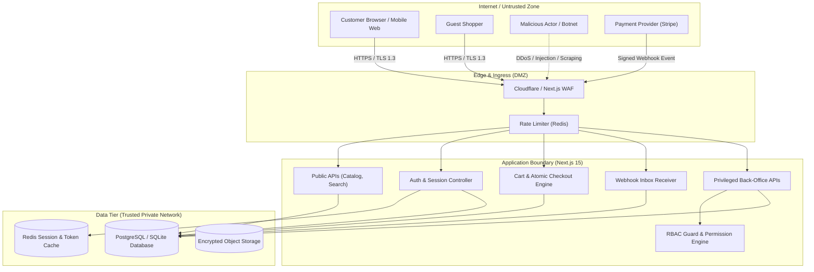

# Security Threat Model and Architecture Review
**Platform:** Production-Grade E-Commerce System  
**Standard:** OWASP Top 10 (2021), OWASP API Security Top 10 (2023), PRD Sections 13 & 18  
**Classification:** Confidential — Internal Security Baseline  

---

## 1. Threat Modeling Methodology & System Decomposition

### 1.1 Architecture & Trust Boundaries

### 1.2 STRIDE Threat Surface Analysis

| Surface / Boundary | Threat (STRIDE) | Attack Vector | Security Control Enforced |
|---|---|---|---|
| **Public Storefront** | Denial of Service / Tampering | SSRF via `/_next/image`, search scraping, brute force | Strict `remotePatterns` whitelist, Redis sliding-window rate limiting. |
| **Authentication Flow** | Spoofing / Repudiation | Credential stuffing, brute force, session fixation | bcrypt (cost 12), single-use reset tokens (15-min TTL), session rotation on login. |
| **Cart & Pricing Engine** | Tampering / Elevation of Privilege | Price manipulation, negative quantities, basis points overflow | Server-side recalculation in `MoneyEngine`, negative amount denial, atomic reservations. |
| **Checkout Pipeline** | Tampering / Information Disclosure | Concurrent over-selling, double coupon redemption | Transactional isolation (`SELECT FOR UPDATE`), unique `PromotionRedemption` constraint. |
| **Webhook Ingestion** | Spoofing / Replay | Forged payment confirmation events, duplicate credits | HMAC-SHA256 signature verification, 300s timestamp tolerance, `(provider, eventId)` idempotency. |
| **Back-Office Admin** | Elevation of Privilege / IDOR | Broken object authorization, UI-only restriction bypass | Server-side `assertPermission()` against PRD Section 13 matrix, actor ownership checks. |
| **Audit & Storage Tier** | Information Disclosure | Plaintext PII/cardholder leakage in logs | Redaction pipeline for `AuditLog.metadataDiff`, Zero PAN storage (PCI-DSS SAQ-A). |

---

## 2. OWASP Top 10 Vulnerability Matrix & Mitigations

### 2.1 A01:2021 — Broken Access Control (BOLA / IDOR)
- **Risk:** Accessing `/api/v1/orders/{id}` or modifying addresses of other customers.
- **Mitigation:**
  1. Internal CUIDs never exposed as primary lookup keys in user-facing endpoints.
  2. Public references use non-guessable NanoIDs (`ORD-YYYY-XXXX`).
  3. Every database query filters by `customerId: session.user.id` unless caller has verified `orders:read` staff permission.
  4. Role matrix strictly enforced server-side; UI visibility flags are never trusted.

### 2.2 A02:2021 — Cryptographic Failures
- **Risk:** Weak password hashes, compromised session cookies, predictable tokens.
- **Mitigation:**
  1. Password hashing with bcrypt (rounds = 12).
  2. Stateless encrypted session cookies via `iron-session` (`HttpOnly`, `Secure`, `SameSite=Lax/Strict`).
  3. Cryptographic tokens generated via `crypto.randomBytes(32)` and stored as SHA-256 hashes.

### 2.3 A03:2021 — Injection (SQL, NoSQL, SSRF)
- **Risk:** Unsanitized database input, SSRF via Next.js image proxy.
- **Mitigation:**
  1. Prisma ORM strictly parameterizes all SQL queries.
  2. Zod schemas validate all incoming request bodies before processing.
  3. Next.js image optimizer locked down: wildcard `hostname: "**"` eliminated.

### 2.4 A04:2021 — Insecure Design & Concurrency
- **Risk:** Race condition during flash sales leading to inventory overselling or promo exhaustion.
- **Mitigation:**
  1. Atomic inventory deduction inside database transactions.
  2. Unique composite constraints `@@unique([promotionId, orderId])`.
  3. Server recalculates all cart prices, taxes, and shipping fees from the ground truth catalog.

### 2.5 A05:2021 — Security Misconfiguration
- **Risk:** Verbose error stack traces, missing security headers.
- **Mitigation:**
  1. Standardized JSON error response without internal exception details (PRD Section 17.2).
  2. Security response headers configured in Next.js (`X-Frame-Options: DENY`, `X-Content-Type-Options: nosniff`, `Referrer-Policy: strict-origin-when-cross-origin`).

---

## 3. Security Verification Checklist

- [x] Passwords hashed with bcrypt (salt rounds = 12).
- [x] Passwords must be between 8 and 72 characters (preventing bcrypt truncation).
- [x] Password reset tokens are single-use with 15-minute expiration, hashed with SHA-256 in DB.
- [x] Session cookies use `HttpOnly`, `Secure`, and `SameSite` flags.
- [x] Session IDs rotated upon authentication or privilege change.
- [x] Server-side RBAC guard (`src/lib/rbac.guard.ts`) enforced on all admin routes.
- [x] Zero credit card or CVV storage (PCI-DSS SAQ-A compliant via tokenized payment provider).
- [x] Payment webhooks verified via HMAC signatures and timestamp tolerance.
